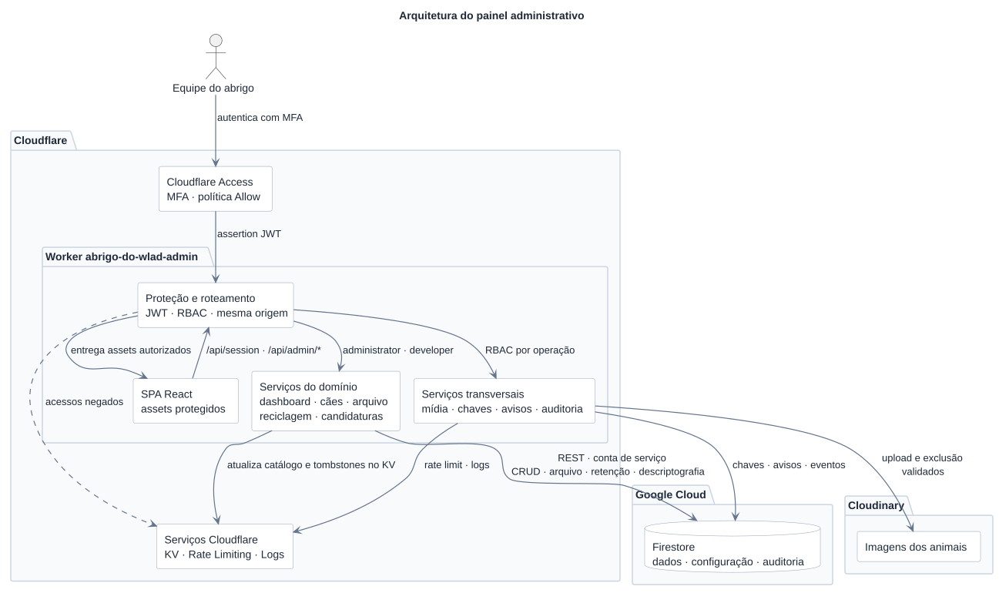

# Painel administrativo

Aplicação interna do Abrigo do Wlad para gerenciar animais, pontos de
reciclagem, candidaturas, imagens e avisos do painel.

## Arquitetura e segurança

O Cloudflare Access autentica o usuário, e o Worker valida o JWT e autoriza o
e-mail como `developer` ou `administrator`. O navegador não recebe credenciais
administrativas nem acessa o Firestore ou o Cloudinary diretamente.

Banco de dados, descriptografia e mídia passam pela API do Worker. Credenciais,
chaves e listas de e-mails autorizados ficam apenas no runtime. O roteiro de
configuração e publicação está em
[`docs/security/access-and-rules-rollout.md`](../../docs/security/access-and-rules-rollout.md).

O ambiente da aplicação é definido por `APP_ENV` no `wrangler.jsonc`:
`local` no desenvolvimento e `production` no Worker padrão, seguindo o mesmo
valor usado pelos Workers público e cron.

```text
apps/admin/
├── public/       # Arquivos estáticos
├── src/          # SPA, componentes, páginas e cliente da API
├── worker/       # Autenticação, API, auditoria, mídia e notificações
├── package.json
└── wrangler.jsonc
```

Os componentes compartilhados vêm do workspace
[`@jaci/ui`](../../packages/ui).

### Diagrama



Fonte: [`docs/admin-architecture.puml`](../../docs/admin-architecture.puml). Após
alterá-la, execute `npm run docs:diagrams` na raiz e versione o SVG gerado.

## Desenvolvimento local

Execute os comandos na raiz do monorepo.

### Interface com dados simulados

```bash
npm run dev:admin:mock
```

Inicia apenas o Vite, sem `.env` ou serviços externos. A sessão usa o papel
`developer`, e as alterações ficam em memória até a página ser recarregada. O
cabeçalho identifica o modo com **Dados simulados**.

O mock só funciona no servidor de desenvolvimento e não cria bypass no Worker
ou nos builds de produção.

### Interface integrada ao Worker

```bash
npm install
npm run dev:admin
```

Inicia Vite e Worker na mesma origem, no ambiente `local`. Sem uma assertion
válida do Access, `/api/session` responde `401`; não há identidade simulada
nesse modo.

Use [`.dev.vars.example`](.dev.vars.example) como referência para a configuração
local em `apps/admin/.dev.vars.local`. O ambiente `local` escolhe esse arquivo
quando ele existe; caso contrário, usa `apps/admin/.dev.vars`. Não há mesclagem:
`.dev.vars.local` precisa conter todos os valores necessários.
Esse comportamento segue a
[precedência de arquivos do Cloudflare](https://developers.cloudflare.com/workers/local-development/environment-variables/).
Valores reais devem permanecer em secrets de runtime e nunca ser versionados.
Os arquivos `.dev.vars.local` e `.dev.vars` da raiz pertencem ao Worker público. O
[`.env.example` da raiz](../../.env.example) contém apenas valores públicos de
build, incluindo `VITE_PUBLIC_APP_URL`, usado pelo painel para abrir o site.

### CRUD real no Firebase de desenvolvimento

```bash
npm run dev:admin:local
```

Abra `http://127.0.0.1:5174`. Esse comando usa uma entrada separada do Worker,
com identidade `local-administrator@example.test` e papel `administrator`, sem
exigir Cloudflare Access. O cabeçalho identifica **DB de desenvolvimento**.
As alterações são reais e ficam no Firestore; não são dados simulados.

Configure `apps/admin/.dev.vars.local` (ou `.dev.vars`, como fallback) com
`FIREBASE_PROJECT_ID=abrigo-do-wlad-dev`, uma conta de serviço cujo e-mail termine
em `@abrigo-do-wlad-dev.iam.gserviceaccount.com`, sua `FIREBASE_PRIVATE_KEY` e
`MASTER_KEY`. Configure também Cloudinary para testar operações de mídia. As
variáveis de Access não são necessárias nesse modo. A conta local deve ter
permissões IAM somente no projeto de desenvolvimento.

Para uma configuração inicial, copie o exemplo sem substituir arquivos já
configurados:

```bash
cp apps/admin/.dev.vars.example apps/admin/.dev.vars.local
```

Se o público acessa o mesmo banco, a `MASTER_KEY` dos dois Workers deve ser a
mesma que protege `system/keys` nesse Firestore.

Para testar funções exclusivas de desenvolvedores:

```bash
ADMIN_LOCAL_ROLE=developer npm run dev:admin:local
```

A identidade é escolhida no início do servidor; cabeçalhos e payloads não
selecionam o papel. Origem das mutações, validação dos dados, autorização por
papel e auditoria continuam ativas.

O servidor escuta exclusivamente em `127.0.0.1:5174`, recusa alterações de host
ou porta. No modo local, o Vite serve páginas e arquivos diretamente, e somente
as rotas `/api/*` passam pelo Worker e pela identidade local. O servidor
desativa túnel, inspector e bindings remotos, e rejeita requisições
com origem externa ou cabeçalhos de encaminhamento. Antes de autenticar cada
requisição, o Worker confere o projeto e a conta de serviço. Sem a constante
injetada apenas pelo Vite nesse modo, a entrada local recusa autenticação.

O modo `local-admin` é proibido em build e preview. Builds do painel exigem modo
`production` e recusam `CLOUDFLARE_ENV` de desenvolvimento. O Wrangler de produção
continua apontando para `worker/index.ts`, que não importa a entrada local e
continua exigindo o JWT do Access. Não exponha o servidor local por proxies
ou ferramentas externas de túnel.

## API administrativa

Todas as rotas exigem identidade válida do Cloudflare Access; mutações também
validam origem e payload.

| Recurso      | Rotas                                                     | Operações                                                 |
| ------------ | --------------------------------------------------------- | --------------------------------------------------------- |
| Sessão       | `/api/session`                                            | Identidade e papel atuais.                                |
| Dashboard    | `/api/admin/dashboard`                                    | Métricas, retenção e aviso ativo.                         |
| Animais      | `/api/admin/dogs[/:id]`                                   | Cadastro, consulta e edição; `GET /dogs?state=archived` lista arquivados. |
| Arquivo      | `/api/admin/dogs/:id/archive`, `/api/admin/dogs/:id/restore` | `POST` para arquivar ou restaurar; não há exclusão definitiva pela API. |
| Reciclagem   | `/api/admin/recycle-points[/:id]`                         | Consulta e CRUD.                                          |
| Candidaturas | `/api/admin/adoptions`, `/api/admin/adoptions/:id/status` | Consulta e atualização de status.                         |
| Auditoria    | `/api/admin/audit-log`                                    | Últimos 100 eventos; somente `developer`.                 |
| Mídia        | `/api/admin/media/upload`, `/api/admin/media/delete`      | Upload e exclusão validados.                              |
| Avisos       | `/api/admin/notifications`                                | Leitura geral; escrita e remoção somente por `developer`. |

Uploads aceitam uma imagem JPEG, PNG ou WebP de até 20 MB e 64 megapixels. O
Worker limita a versão persistida a 5 MB, tenta uma segunda otimização em WebP
quando necessário e aplica o limite de 12 uploads por minuto por identidade.

Avisos têm `message` (1–240 caracteres), `type` (`trivial`, `urgent`, `success`
ou `info`) e `expiration` (`1h`, `6h`, `12h` ou `until_deleted`). O Worker
calcula `expiresAt`; avisos vencidos deixam de aparecer automaticamente.

Ao aprovar ou reprovar uma solicitação, o Worker antecipa `expiresAt` para a
última execução diária do cron (03h UTC) dentro dos próximos 7 dias, respeitando
o vencimento original de 30 dias desde o envio. `originalExpiresAt` preserva o
prazo original e `decisionExpiresAt` preserva a janela da primeira decisão.
O botão **Reconsiderar**, na lista e na ficha, devolve a solicitação para
`pending` antes do vencimento e restaura seu prazo original. Decisões posteriores
não prorrogam a janela de exclusão da primeira decisão. Alterações de status e
exclusões pelo cron exigem que a versão do documento continue igual à consultada.
Essa programação depende do cron diário; mudanças no horário precisam ser
refletidas em `shared/adoption-retention.ts`.

O cron usa `ADOPTION_CLEANUP_MODE=delete` em produção e `dry-run` no ambiente
local. A nova programação é aplicada ao alterar o status; decisões anteriores
sem esses campos mantêm o vencimento já armazenado até uma nova ação da equipe.

As principais mutações geram eventos em `admin_audit_log` sem copiar payloads,
candidaturas ou URLs de mídia. Mudanças em animais também agendam a reconstrução
do catálogo público no KV, que pode levar um breve período para convergir entre
regiões.

O arquivamento recebe `reason: "adopted_via_site" | "other"`, preserva o documento
e suas fotos e grava `archivedAt`, `purgeAfter`, `archiveReason` e `archivedBy`.
`purgeAfter` é calculado 30 dias após o arquivamento de cada cão. A restauração
remove o estado de arquivo e o tombstone público. A descoberta de candidatos à
limpeza está em `workers/shared/api/dogs/purge-candidates.ts`. O cron consulta
esse prazo diariamente e exclui os documentos elegíveis quando `DOG_PURGE_MODE`
está em `delete`; em `dry-run`, apenas registra a quantidade encontrada.
Ausência ou valor inválido mantém a tarefa desativada. A exclusão usa a versão
do documento lida na consulta para impedir que uma restauração concorrente seja
apagada. As imagens no Cloudinary permanecem armazenadas após a limpeza do
documento.
Fotos retiradas do cadastro permanecem registradas em `retainedPhotos`. O
endpoint de mídia recusa a exclusão de imagens ligadas a qualquer cão.

## Publicação

A configuração está em [`wrangler.jsonc`](wrangler.jsonc). Para verificar e
publicar o painel, siga o
[roteiro de publicação](../../docs/security/access-and-rules-rollout.md).
